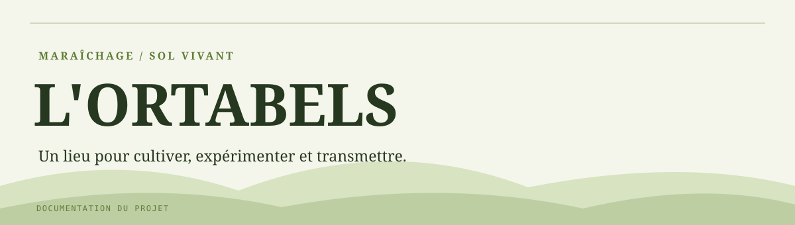

# L'Òrtabels

Site vitrine de l'association L'Òrtabels, dédiée au maraîchage sur sol vivant, à l'agroécologie et au partage de pratiques autour du jardin.

Le dépôt contient un site **Hugo** avec contenus éditoriaux en Markdown, un thème et des ressources statiques. Il s'agit du site vitrine de l'association, **distinct** de l'application métier [L'Ortabels](https://github.com/J-Rbs91/Ortapplication).

## Contenu

- **Accueil** : présentation du lieu et de l'association dans [`content/_index.md`](content/_index.md).
- **Projets** : articles et contenus dans [`content/projets/`](content/projets/).
- **Galerie** : pages et visuels dans [`content/galery/`](content/galery/).
- **Contact** : informations dans [`content/contact.md`](content/contact.md).
- **Design** : thème Hugo, ressources dans [`assets/`](assets/) et [`static/`](static/), configuration dans [`config/_default/`](config/_default/).

## Prévisualiser en local

Hugo est requis. Le projet dispose de son propre thème ; récupérer également les sous-modules Git s'il y en a sur le clone local.

```sh
git clone https://github.com/J-Rbs91/OrtaWeb.git
cd OrtaWeb
hugo server -D
```

La prévisualisation est en général accessible sur `http://localhost:1313/`.

## Publication

Le fichier [`netlify.toml`](netlify.toml) décrit une construction par `hugo --gc --minify`, avec publication du dossier `public/`. La configuration du site référence le domaine `www.ortabels.fr` et un environnement Netlify. Cela décrit le paramétrage versionné, **pas une preuve de disponibilité du domaine ni de déploiement actuel**.

## Précautions

Les contenus et ressources du site peuvent être publics. Ne pas placer de secrets ou d'identifiants d'administration dans les fichiers versionnés, ni utiliser un contrôle purement côté client comme frontière de sécurité.
